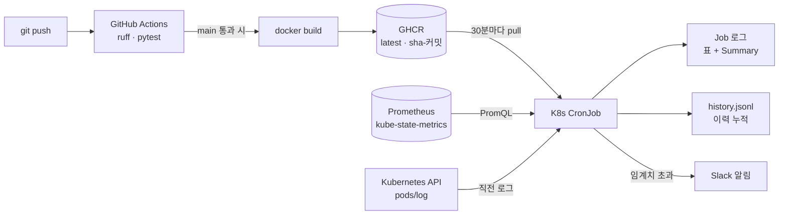

# Pod Restart Inspector


Prometheus 에서 Kubernetes 컨테이너 재시작 메트릭을 조회해
**최근 N분/시간 동안 재시작이 잦은 컨테이너**를 종료 사유(OOMKilled / Error), 재시작 직전 로그와 함께 요약하고
Slack 으로 알리는 도구입니다. CLI 로 바로 쓰거나, 컨테이너 이미지로 만들어 클러스터 안의 CronJob 으로 주기 실행합니다.



**Stack**: Python 3.12 (표준 라이브러리만) · PromQL · GitHub Actions · GHCR · Kubernetes CronJob / RBAC · Slack Webhook

## Why
OpsRamp로 K8s 클러스터를 관측하면서, 반복적으로 죽는 컨테이너를 찾으려면 대시보드에서 Pod별 Restart 그래프를 하나씩 열어봐야 했습니다.
`kubectl get pods`의 RESTARTS는 Pod 생성 이후 누적값이라 "지금 문제인지"를 구분하기 어렵습니다.
그래서 **기간 기준으로, 왜 죽었는지까지** 한 번에 확인하고 장애 기록에 바로 붙일 수 있는 도구를 만들었습니다.

## Features
**탐지**
- `increase(kube_pod_container_status_restarts_total[window])` 로 **기간 내 재시작 횟수** 집계 (누적값 아님)
- `kube_pod_container_status_last_terminated_reason` 결합 → OOMKilled / Error 구분, **Pod 가 이미 삭제됐어도** 기간 내 마지막 사유 표시
- 임계치 필터, 재시작 횟수 내림차순 정렬, `[Summary]` 요약 (OOMKilled 면 memory limit 점검 안내)
- 시스템 네임스페이스(kube-system, monitoring 등) 기본 제외, `--namespace` / `--exclude-ns` 로 조정

**진단 · 기록**
- `--logs N`: 재시작 직전 로그(`--previous`) 마지막 N줄 — 클러스터 밖에서는 kubectl, 안에서는 Kubernetes API 직접 호출
- `--save FILE`: 실행 결과를 JSON Lines 로 누적 → Pod 가 삭제돼 메트릭이 사라져도 이력 보존
- 출력 형식: `table` / `json` / `markdown`

**운영**
- `--slack-webhook URL` (또는 `SLACK_WEBHOOK_URL`): 임계치 초과 시에만 Slack 알림
- 종료 코드 `0` 정상 · `1` 임계치 초과 · `2` 조회 실패 또는 잘못된 인자 → cron / CI 알림 조건으로 사용
- 입력값 검증(`--window`, `--namespace`, `--exclude-ns`), 저장·알림 실패는 경고만 하고 종료 코드 유지
- main push → 테스트 → 이미지 빌드 → GHCR → CronJob 이 최신 이미지로 실행

## Quick Start (CLI)
```bash
# 1) Prometheus 접근 (kube-prometheus-stack 기준)
kubectl port-forward -n monitoring svc/kps-kube-prometheus-stack-prometheus 9090:9090 &

# 2) 실행
python3 main.py --window 30m --threshold 2
python3 main.py --namespace default --output json
python3 main.py --output markdown > report.md

# 3) 직전 로그 20줄 + 이력 저장 + Slack 알림 (webhook 은 화면/히스토리에 남지 않게 입력)
read -rs SLACK_WEBHOOK_URL && export SLACK_WEBHOOK_URL
python3 main.py --window 30m --threshold 2 --logs 20 --save history.jsonl
```

```
$ python3 main.py --window 30m --threshold 2
NAMESPACE  POD       CONTAINER  RESTARTS  LAST_REASON
default    oom-test  app        4         OOMKilled
default    crasher   crasher    3         Error

[Summary] window=30m, threshold=2
2 container(s) exceeded restart threshold.
Highest: default/oom-test/app = 4 (last reason: OOMKilled)
OOMKilled: 1 container(s) -> memory limit 확인 필요
```


`--save` 파일은 실행마다 한 줄씩 추가됩니다 (임계치 초과가 없어도 빈 목록으로 기록).
```json
{"time": "2026-10-19T05:24:26+00:00", "window": "30m", "threshold": 3, "containers": [{"namespace": "default", "pod": "crasher", "container": "crasher", "restarts": 4, "last_reason": "Error", "previous_logs": "start"}]}
```

## CronJob 배포
이미지는 GitHub Actions 가 테스트 통과 후 main push 마다 빌드해 `ghcr.io/hyojinny-k/pod-restart-inspector`
(`latest`, `sha-<커밋>`)에 올립니다. 노드에 docker 나 빌드 도구가 필요 없습니다.

```bash
# 1) 이미지 받아지는지 확인 (노드에서)
sudo crictl pull ghcr.io/hyojinny-k/pod-restart-inspector:latest

# 2) 배포 + Slack Secret
kubectl apply -f deploy/cronjob.yaml
kubectl -n pod-restart-inspector create secret generic slack-webhook --from-literal=url="$SLACK_WEBHOOK_URL"

# 3) 스케줄을 기다리지 않고 바로 한 번 실행
kubectl -n pod-restart-inspector create job --from=cronjob/pod-restart-inspector manual-1
kubectl -n pod-restart-inspector logs job/manual-1
cat /var/lib/pod-restart-inspector/history.jsonl   # control-plane 노드
```

`deploy/cronjob.yaml` 구성
| 항목 | 설정 | 이유 |
|---|---|---|
| 주기 | `*/30 * * * *`, `--window=30m` | 실행 간격과 조회 기간을 맞춰 빈틈·중복 없이 확인 |
| 권한 | ServiceAccount + ClusterRole `pods/log` get 만 | 로그 읽기에 필요한 최소 권한 |
| 이미지 | `latest` + `imagePullPolicy: Always` | push 하면 다음 실행부터 자동 반영 |
| 종료 코드 | 1(임계치 초과)은 Job 성공, 2(조회 실패)만 실패 | "알릴 게 있음"과 "도구 고장"을 구분 |
| 재시도 | `backoffLimit: 0`, `concurrencyPolicy: Forbid` | 재시도·중복 실행으로 Slack 알림이 반복되지 않게 |
| 이력 | control-plane hostPath `/var/lib/pod-restart-inspector` | 별도 스토리지 없이 한 곳에 누적 (시간은 UTC) |
| 보안 | non-root(10001), read-only rootfs, privilege escalation 금지 | |

## Verification
실제 클러스터에서 `examples/crash-pods.yaml` 로 장애를 재현하고, 결과를 `kubectl` 상태와 대조했습니다.

| 항목 | 구성 |
|---|---|
| Cluster | kubeadm v1.29.15, 3 nodes (control-plane 1, worker 2), Ubuntu 24.04 |
| Runtime / CNI | containerd 2.2.1 / Calico v3.27.0 |
| Monitoring | kube-prometheus-stack (Helm), kube-state-metrics |

```bash
kubectl apply -f examples/crash-pods.yaml   # 20초마다 exit 1 하는 Pod + 64Mi 제한에서 OOMKilled 되는 Pod
# 10~15분 대기
python3 main.py --window 30m --threshold 2
kubectl describe pod oom-test crasher | grep -A3 "Last State"
```

**CLI**
| 검증 항목 | 도구 결과 | `kubectl` 실제 상태 | 결과 |
|---|---|---|---|
| oom-test 재시작 횟수 | 4 | RESTARTS 4 | ✅ |
| crasher 재시작 횟수 | 3 | RESTARTS 3 | ✅ |
| oom-test 종료 사유 | OOMKilled | Last State: Terminated, Reason OOMKilled, Exit Code 137 | ✅ |
| crasher 종료 사유 | Error | Last State: Terminated, Reason Error, Exit Code 1 | ✅ |
| 임계치 초과 시 종료 코드 | `exit=1` | - | ✅ |
| Prometheus 연결 실패 | `exit=2` + 에러 메시지 | - | ✅ |
| 삭제된 Pod 종료 사유 | `-` 대신 `Error` | Pod 삭제 후 실행 | ✅ |

> `CrashLoopBackOff` 는 재시작을 기다리는 **대기(Waiting) 상태**이고, 도구가 보여주는 값은
> 마지막 **종료(Terminated) 사유**입니다. 그래서 비교는 `describe` 의 `Last State` 기준으로 합니다.

**CronJob · 파이프라인**
```
$ kubectl -n pod-restart-inspector logs job/manual-2
NAMESPACE  POD       CONTAINER  RESTARTS  LAST_REASON
default    oom-test  app        4         OOMKilled
default    crasher   crasher    4         Error

[Summary] window=30m, threshold=3
2 container(s) exceeded restart threshold.
Highest: default/oom-test/app = 4 (last reason: OOMKilled)
OOMKilled: 1 container(s) -> memory limit 확인 필요

--- default/oom-test/app (previous logs) ---
(로그 없음)

--- default/crasher/crasher (previous logs) ---
start
```

| 검증 항목 | 방법 / 결과 | 결과 |
|---|---|---|
| 이미지 빌드 · 배포 | main push → Actions `test` → `image` 성공, 노드에서 `crictl pull` 성공 | ✅ |
| CronJob 실행 | 수동 Job `Completed` (임계치 초과 exit 1 이어도 Job 성공 처리) | ✅ |
| 클러스터 안 로그 조회 | kubectl 없이 ServiceAccount + API 로 crasher 직전 로그 `start` | ✅ |
| OOMKilled 로그 | 출력 없이 메모리 할당 중 종료 → `(로그 없음)` | ✅ |
| 이력 저장 | hostPath `history.jsonl` 에 실행마다 1줄 | ✅ |
| Slack 알림 | 임계치 초과 시 채널에 표 + 요약 수신 (CLI 실행으로 확인), 초과 없으면 미발송 | ✅ |
| 삭제된 Pod 로그 | `(Pod 가 이미 삭제되어 로그를 볼 수 없음)` | ✅ |

- 단위 테스트 38개 (`pytest -q`) + `ruff check`, GitHub Actions 에서 push / PR 마다 실행
- 전체 출력: [`sample_output.txt`](sample_output.txt)

## Design Notes
- **누적 카운터 대신 `increase()`**: 오래전에 많이 죽은 Pod 가 상위에 뜨는 문제 방지
- **삭제된 Pod 의 종료 사유**: 재시작 횟수는 기간 내 이력으로 계산되는데 종료 사유를 현재 값으로만 조회하면, 장애 후 Pod 가 삭제됐을 때 `-` 로 나옴
  → `(현재 사유) or on(namespace, pod, container) last_over_time(사유[window])` 로 현재 값이 없을 때만 기간 내 마지막 값을 사용
- **반올림**: `increase()` 는 외삽 때문에 `2.9998` 같은 소수가 나옴. Python `round()` 는 2.5 → 2 라서 사사오입 사용
- **의존성 0**: urllib / json / subprocess 만 사용 → 노드에 pip 설치 없이 실행, 이미지도 작게 유지
- **클러스터 안/밖 로그 조회 분리**: 밖에서는 kubectl, 안에서는 ServiceAccount 토큰으로 API 호출 → 이미지에 kubectl 불필요
- **비밀값 취급**: webhook URL 은 환경변수 / Secret 으로만 받고, 전송 실패 메시지에도 URL 을 출력하지 않음
- kube-prometheus-stack 이 설치하는 kube-state-metrics(monitoring)는 기존 OpsRamp 수집용 kube-state-metrics(kube-system)와 분리해 기존 관측 구성에 영향을 주지 않도록 함

## Limitations
- `--logs` 는 직전 1회 종료 로그만 볼 수 있음 (그 이전 로그는 kubelet 이 보관하지 않음). Pod 가 삭제되면 로그도 볼 수 없음
- 삭제된 Pod 의 종료 사유가 기간 내 여러 번 바뀐 경우 그중 하나만 표시
- CronJob 이력은 control-plane 노드 한 곳의 hostPath → 장기 보관이 필요하면 PVC / 외부 저장소로 변경
- Deployment 처럼 Pod 가 계속 교체되면 재시작이 여러 Pod 이름으로 나뉨 → 워크로드 단위 집계가 필요
- `deploy/cronjob.yaml` 변경은 수동 `kubectl apply` (사내망 클러스터라 GitHub 에서 직접 배포하지 않음, 필요하면 Argo CD 같은 GitOps 로 확장)

## Project Structure
```
main.py            CLI 진입점, 인자 검증, 종료 코드
prom_api.py        Prometheus HTTP API 조회, PromQL 생성
analyzer.py        두 쿼리 결과 결합, 임계치 필터, 정렬
formatter.py       table / json / markdown / Slack 메시지
logs.py            직전 로그 조회 (kubectl 또는 Kubernetes API)
history.py         JSON Lines 이력 저장
notify.py          Slack Incoming Webhook
tests/             단위 테스트 (pytest)
Dockerfile         python:3.12-alpine, non-root
deploy/            CronJob, ServiceAccount, RBAC
examples/          장애 재현용 Pod (crasher, oom-test)
.github/workflows/ CI (ruff, pytest) + GHCR 이미지 빌드
```

## AI 활용과 검증
코드 초안, PromQL, 리뷰와 기능 추가 구현에 AI(Claude)를 활용했습니다. 메트릭 이름과 라벨은
[kube-state-metrics 문서](https://github.com/kubernetes/kube-state-metrics/blob/main/docs/metrics/workload/pod-metrics.md)와
Prometheus 에서 직접 조회한 결과로 대조했고, 새 PromQL 은 반영 전에 실제 Prometheus 에서 먼저 실행해 확인했습니다.
모든 동작은 위 재현 시나리오(실제 클러스터)와 단위 테스트로 검증했습니다.
