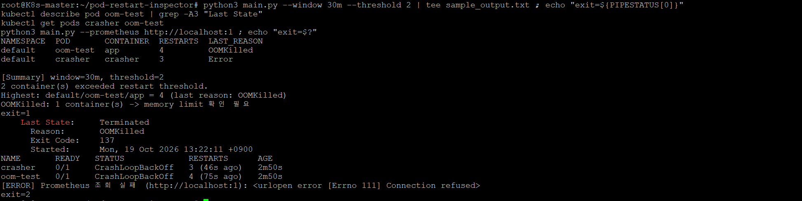

# Pod Restart Inspector


Prometheus API에서 Kubernetes Pod/Container 재시작 메트릭을 조회해
**최근 N시간 동안 재시작이 잦은 컨테이너**를 종료 사유(OOMKilled / Error 등)와 함께 요약하는 CLI 도구입니다.

## Why
OpsRamp로 K8s 클러스터를 관측하면서, 반복적으로 죽는 컨테이너를 찾으려면 대시보드에서 Pod별 Restart 그래프를 하나씩 열어봐야 했습니다.
`kubectl get pods`의 RESTARTS는 Pod 생성 이후 누적값이라 "지금 문제인지"를 구분하기 어렵습니다.
그래서 **기간 기준으로, 왜 죽었는지까지** 한 번에 확인하고 장애 기록에 바로 붙일 수 있는 도구를 만들었습니다.

## Features
- Prometheus HTTP API 조회 (외부 라이브러리 없이 표준 라이브러리만 사용)
- `increase(kube_pod_container_status_restarts_total[window])` 로 **기간 내 재시작 횟수** 집계
- `kube_pod_container_status_last_terminated_reason` 결합 → OOMKilled / Error 구분
- 임계치 필터, 재시작 횟수 내림차순 정렬, `[Summary]` 요약
- 출력 형식: `table` / `json` / `markdown`
- 종료 코드: `0` 정상 · `1` 임계치 초과 · `2` 조회 실패 또는 잘못된 인자 → cron / CI 알림 조건으로 사용 가능
- `--window`, `--namespace`, `--exclude-ns` 입력값 검증 (잘못된 값은 쿼리 전에 에러 메시지로 안내)
- 시스템 네임스페이스(kube-system, monitoring 등) 기본 제외, `--namespace` / `--exclude-ns` 로 조정

## Example
실제 클러스터에서 `examples/crash-pods.yaml` 로 장애를 재현한 뒤 실행한 결과입니다.
```
$ python3 main.py --window 30m --threshold 2
NAMESPACE  POD       CONTAINER  RESTARTS  LAST_REASON
default    oom-test  app        4         OOMKilled
default    crasher   crasher    3         Error

[Summary] window=30m, threshold=2
2 container(s) exceeded restart threshold.
Highest: default/oom-test/app = 4 (last reason: OOMKilled)
OOMKilled: 1 container(s) -> memory limit 확인 필요
```


## Usage
```bash
# 1) Prometheus 접근 (kube-prometheus-stack 기준)
kubectl port-forward -n monitoring svc/kps-kube-prometheus-stack-prometheus 9090:9090 &

# 2) 실행
python3 main.py --window 1h --threshold 3
python3 main.py --namespace default --output json
python3 main.py --output markdown > report.md
python3 main.py --help
```

## Test Environment
| 항목 | 구성 |
|---|---|
| Cluster | kubeadm v1.29.15, 3 nodes (control-plane 1, worker 2), Ubuntu 24.04 |
| Runtime / CNI | containerd 2.2.1 / Calico v3.27.0 (Pod CIDR 10.244.0.0/16) |
| Monitoring | kube-prometheus-stack (Helm), kube-state-metrics |

## Verification
`examples/crash-pods.yaml` 로 장애를 재현하고, 도구 결과를 `kubectl` 상태와 대조했습니다.
```bash
kubectl apply -f examples/crash-pods.yaml   # 20초마다 종료되는 Pod + 메모리 초과(OOMKilled) Pod
# 10~15분 대기
python3 main.py --window 30m --threshold 2
kubectl describe pod oom-test | grep -A3 "Last State"
kubectl describe pod crasher | grep -A3 "Last State"
```

> `CrashLoopBackOff` 는 재시작을 기다리는 **대기(Waiting) 상태**이고, 도구가 보여주는 값은
> 마지막 **종료(Terminated) 사유**입니다. 그래서 비교는 `describe` 의 `Last State` 기준으로 합니다.

| 검증 항목 | 도구 결과 | `kubectl` 실제 상태 | 결과 |
|---|---|---|---|
| oom-test 재시작 횟수 | 4 | RESTARTS 4 | ✅ |
| crasher 재시작 횟수 | 3 | RESTARTS 3 | ✅ |
| oom-test 종료 사유 | OOMKilled | Last State: Terminated, Reason OOMKilled, Exit Code 137 | ✅ |
| crasher 종료 사유 | Error | Last State: Terminated, Reason Error, Exit Code 1 (현재 상태는 CrashLoopBackOff) | ✅ |
| 임계치 초과 시 종료 코드 | `exit=1` | - | ✅ |
| Prometheus 연결 실패 | `exit=2` + 에러 메시지 | - | ✅ |

- 단위 테스트: `pytest -q` (GitHub Actions 에서 push 마다 실행)
- 전체 출력: [`sample_output.txt`](sample_output.txt)

## Design Notes
- **누적 카운터 대신 `increase()`**: 오래전에 많이 죽은 Pod가 상위에 뜨는 문제 방지
- `increase()` 는 외삽 때문에 `2.9998` 같은 소수가 나와 반올림 처리 (Python `round()` 는 2.5 → 2 이므로 사사오입 사용)
- kube-prometheus-stack 이 설치하는 kube-state-metrics(monitoring)는 기존 OpsRamp 수집용 kube-state-metrics(kube-system)와 분리해 기존 관측 구성에 영향을 주지 않도록 함

## Limitations / Next
- Pod가 삭제되면 메트릭도 사라져 이력이 남지 않음 → 결과 주기적 저장
- 재시작 직전 로그 함께 출력 (`kubectl logs --previous`)
- Slack/Webhook 알림, 컨테이너 이미지로 패키징해 CronJob 으로 실행

## AI 활용과 검증
코드 초안과 PromQL 작성에 AI를 활용했습니다. 메트릭 이름과 라벨은
[kube-state-metrics 문서](https://github.com/kubernetes/kube-state-metrics/blob/main/docs/metrics/workload/pod-metrics.md)와
Prometheus 에서 직접 조회한 결과로 대조했고, 동작은 위 재현 시나리오와 단위 테스트로 검증했습니다.
